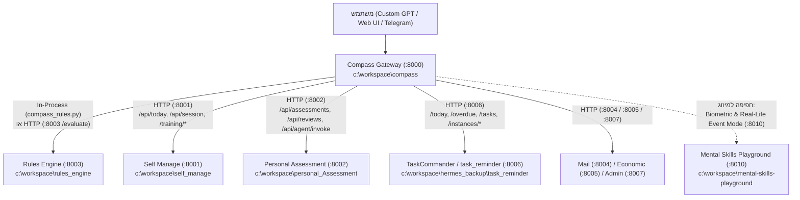

# Compass – Proactive Personal Development: Current State & Phase 0 Architecture Map

Last updated: 2026-11-24  
Status: **Phases 0–6 Implemented, Verified (31/31 Tests PASS) & Synced to GitHub — Developed end-to-end with Antigravity (see [CONTRACTOR_COORDINATION.md](file:///C:/workspace/compass/CONTRACTOR_COORDINATION.md) & [SYSTEM_OPERATION_GUIDE.md](file:///C:/workspace/compass/SYSTEM_OPERATION_GUIDE.md))**

---

## 1. מפת הארכיטקטורה הקיימת (Existing System Map)

מערכת **Compass** (`c:\workspace\compass`, פורט `8000`) פועלת כיום כ-Gateway מרכזי (FastAPI + PostgreSQL/SQLite) עבור Custom GPT, ממשקי Web מקומיים (`/familybiz/`, `/ecosystem-hub/`, `/assessment-ui/`) וסוכן הטלגרם (`accountability_coach`).

### מצב המאגרים המקומיים ומול GitHub

| פרויקט | נתיב מקומי | פורט | מצב Git / סנכרון מול GitHub | תפקיד בפועל |
|---|---|---|---|---|
| **Compass** | `c:\workspace\compass` | `8000` | `master...origin/master [ahead 3]` + קבצים מקומיים שטרם הוכנסו ל-commit (`mental_skills.py`, `progress.py`, `accountability_coach.py`, `ecosystem_hub.py`) | שער מרכזי, הקשר בוקר, תוכנית יומית, תור אישורים (`approval_requests`), יומן הערכות כללים (`rule_evaluations`), מעקב שבועי (`progress/weekly`), ו-MVP של אימון מנטלי (`msp_*`) |
| **rules_engine** | `c:\workspace\rules_engine` | `8003` | `master...origin/master` – **סונכרן ונדחף במלואו ל-GitHub (`727995e`)** | שני מנועים באותו מאגר: 1) `compass_rules.py` – מנוע כללים מובנה ודטרמיניסטי לאירועים (`StructuredEvent -> EvaluationResult`), 2) `rule_engine_agent.py` (`FamilyDecisionManager`) – מנוע YAML עם תור `review_queue.json` וגיבוי Ollama אופציונלי |
| **self_manage** | `c:\workspace\self_manage` | `8001` | `master...origin/master` + שינויים מקומיים בתרגילים, מדידת תוצאות/בטיחות ומיגרציית `mental_skills` | ספריית תרגילים (`cognitive`, `mental`, `physical`), מחולל תוכנית יומית (`/api/today/generate`), לוג ביצוע עם מדדי לפני/אחרי ודגל בטיחות (`safety_issue`), וזיכרון אימון רפלקטיבי (`/training/*` שהחליף את `self_trainer`) |
| **personal_Assessment** | `c:\workspace\personal_Assessment` | `8002` | `master...origin/master` + שינויים מקומיים | מבחנים אובייקטיביים (`/battery`: זמן תגובה, חיסור סדרתי, שיווי משקל, החלפות הקשר), דיווח עצמי (`MetricEntry`, `SubjectAssessment`), מחולל סקירות (`weekly`, `monthly`, `quarterly`, `yearly`), חישוב רמת ביטחון (`ConfidenceService`), וייצוא ממצאים ל-Compass / Self Manage |
| **TaskCommander** | `c:\workspace\TaskCommander` (ריק) / מימוש בפועל: `c:\workspace\hermes_backup\task_reminder` (ובמקביל `c:\workspace\task_bubbles`) | `8006` | `c:\workspace\TaskCommander` מכיל רק `.git` ריק; המימוש המלא של `Task` + `TaskInstance` + סנכרון יומן/משימות/טלגרם נמצא ב-`c:\workspace\hermes_backup\task_reminder` | ניהול משימות תפעוליות, משימות חוזרות (`recurrence_rule`), מופעים יומיים (`TaskInstance`: `pending`, `done`, `snoozed`, `skipped`), ותזכורות טלגרם |
| **mental-skills-playground** | `c:\workspace\mental-skills-playground` | `8010` | `master` + הרחבות Real-Life Event Mode (`msp_real_life_events`), ביופידבק (Fitbit Charge 6 BLE), והתערבות שקטה | סביבת אימון מנטלי + מצב אירוע אמת (`IDLE -> ACTIVE -> COMPLETED -> ANALYZED`), הערכת ויסות פיזיולוגי מול הצלחה התנהגותית, והתאמת אימונים |

---

## 2. מיקום מנוע הכללים בפועל (Actual Rule Engine Location & Dual-Mode Analysis)

בעוד שבעבר מאגר GitHub `mordsm/rules_engine` הכיל רק `README.md`, המימוש המקומי המלא אותר ב-`c:\workspace\rules_engine` וכבר נדחף ל-GitHub בקומיט `727995e`.

בפועל קיימים ב-`c:\workspace\rules_engine` **שני מסלולי הערכה**:

1. **המסלול המובנה (`compass_rules.py` – `evaluate_structured_event`)**:
   - נקרא מתוך `Compass` (`app/services/rules_engine.py -> evaluate_event()`) **In-Process** (ייבוא ישיר של `compass_rules.py` ללא תקורת רשת, עם נפילה ל-HTTP `POST /api/rules/evaluate` בפורט `8003`).
   - מקבל `StructuredEvent` עם ולידציית Pydantic קשיחה (`event_id`, `event_type`, `source`, `user_id`, `occurred_at`, `payload`, `idempotency_key`).
   - מחזיר `EvaluationResult` עשיר: `final_decision` (`block`, `require_approval`, `allow_with_redaction`, `allow_read_only`, `allow`, `recommendation_only`), `risk_level`, `matched_rules` (כולל `rule_id`, `version`, `priority`), `reason_codes`, `allowed_actions`, `approval_required_actions`, `blocked_actions`, `routes`, ו-`explanation` דטרמיניסטי.
   - כל הערכה נשמרת ב-Compass בטבלת `rule_evaluations` וב-`audit_log`.
2. **המסלול הישן (`rule_engine_agent.py` – `FamilyDecisionManager.decide`)**:
   - נקרא דרך `POST /evaluate` (מ-`POST /api/daily-plan` ומ-`POST /api/context/morning`).
   - קורא מ-`family_config.yaml`, שומר תור נפרד בקובץ `review_queue.json` והיסטוריה ב-`decision_history.json`, ומכיל קריאה אופציונלית ל-Ollama מקומי (`enabled: true` ב-`family_config.yaml`).

> **ממצא קריטי לשלב 1:** יש לאחד את כל החלטות Compass תחת המודל הדטרמיניסטי המובנה של `compass_rules.py` (עם טעינת קטלוג כללים מגרסאות נתונים/YAML ללא הפעלת Ollama אוטומטית), ולהפסיק שימוש בתור כפול ב-`review_queue.json` לטובת טבלת `approval_requests` ו-`rule_evaluations` ב-Compass.

---

## 3. מיפוי הדרישות במסמך מול היכולות הקיימות (Requirements vs. Existing Capabilities)

| סעיף במסמך האפיון | קיים כיום במערכת | חלקי / דורש התאמה | חסר (לפיתוח) |
|---|---|---|---|
| **3. Compass כמנהל מרכזי + Rule Engine First** | Compass מרכז הקשר בוקר (`/api/context/morning`), הפעלת סוכנים (`/api/agents/invoke`), הערכת כללים (`/api/rules/evaluate`) ותור אישורים (`/api/approvals`). | `POST /api/daily-plan` שומר את התוכנית בסטטוס `approved` **לפני** הרצת `rules_engine.evaluate`! כמו כן, אישור בקשה ב-`/api/approvals/{id}/approve` משנה סטטוס אך טרם מפעיל Executor ייעודי. | הפרדת סטטוס תוכנית יומית (`proposed -> evaluated -> pending_approval / active`), ו-Approved Action Executor מבוקר. |
| **4. מודל מטרות ארוכות טווח והיררכיית תחומים** | ב-`self_manage` קיימת טבלת `domain` (`cognitive`, `mental`, `physical`) וב-`ecosystem_hub` קיימים חלונות פרויקטים. | אין הבחנה מובנית בין **תחומי ליבה** (מנטלי, פיזי, AI מקצועי) לבין **תחומי העשרה** (בישול, גינון, נגינה, ציור), ואין שדות רמה נוכחית/רצויה, חשיבות מול רמת התערבות, או בדיקת הזנחה (`GROWTH-001/002`). | טבלת/מודל `growth_domains` ו-`long_term_goals` עם היררכיה (`core` מול `enrichment`), משקלים, תדירות רצויה, מגבלות ומועד הערכה הבא. |
| **5. מנגנון הצפרדעים (Eat That Frog)** | קיימות משימות ב-Compass (`tasks`) וב-`task_reminder` (`tasks`, `task_instances`), וכן בדיקת דחייה של יומיים ב-`accountability_coach`. | אין ישות `Frog` ייעודית המבחינה בין משימה רגילה לבין פעולה המעוררת התנגדות רגשית/הימנעות. | מודל ומאגר צפרדעים (`frogs`, חד-פעמית מול מתמשכת), ניקוד התנגדות/חשיבות/דחיפות, שמירה על מינימום 4 צפרדעים פעילות בבדיקת ערב ללא המצאת צפרדעים (`FROG-001..004`), ובחירה יומית דטרמיניסטית. |
| **6. הפחתת התנגדות להתחלת פעולה** | ב-`self_manage` וב-`mental-skills-playground` קיימים תרגילי `PAUSE` ו-`AROUSAL_REGULATION` (נשימה/סריקת גוף). | אין פרוטוקול הכנה קצר בן 6 שלבים המחובר לפני התחלת צפרדע או אימון מאתגר עם דגימת מתח תקופתית. | פרוטוקול הכנה מותאם אישית לפני פעולה מאתגרת + דגימה תקופתית קצרה (מתח לפני/אחרי הכנה, תחושה אחרי ביצוע). |
| **7. ניהול שגרות והרגלים** | ב-`self_manage` קיים תור תרגילים יומי ו-Hotkey, וב-`task_reminder` קיימות משימות חוזרות (`recurrence_rule`). | חסרה הגדרת שגרה כרצף פעולות עם **גרסה מינימלית** (`minimum_viable_version`), תנאי התחלה, ותנאי דילוג ללא ענישה (`HABIT-001`). | מודל `routines` ב-Compass/Self Manage עם תמיכה בגרסה מינימלית אוטומטית בעת התנגדות או אנרגיה נמוכה. |
| **8. מערכת אתגרים ואתגור אדפטיבי** | ב-`compass/app/services/mental_skills.py` קיימת התאמת קושי בסיסית (רמות 1–2) וב-`self_manage` סינון לפי `difficulty_level` ודגל `safety_issue`. | אין מערכת אתגרים רוחבית (מנטלי, פיזי, מקצועי, קוגניטיבי, יצירתי, לימודי) המזהה דריכה במקום (`stagnation`) או העמסה ומציעה שינוי קושי בגבולות מאושרים (`CHALLENGE-001/002`). | מודל `challenges` + כללי אתגור אדפטיביים ב-`rules_engine` עם אכיפת גבולות בטיחות ואיסור העלאת עומס גופני בעת כאב/מגבלה. |
| **9. משחקיות והנעה** | ב-`TASK_BRIEF.md` וב-`docs/mental-skills-playground/GAME_DESIGN.md` קיים אפיון עולם אימון ורצפים ב-`accountability_coach`. | ב-`accountability_coach` הטון הנוכחי נוקשה ("zero-tolerance"), שעלול לסתור את הדרישה להימנע מענישה על שבירת רצף או לחץ מיותר. | מנגנון משחקיות חיובי ומבוקר (ניקוד על התחלת פעולה והתמודדות עם התנגדות, רצפים גמישים ללא ענישה על דילוג, הפרדה מוחלטת בין ניקוד משחקי למדדי הערכה). |
| **10. הפרדה בין תפקיד המתכנן לתפקיד המבצע** | קיימים מצבי תכנון וביצוע מפוזרים בין ה-GPT לבין `self_manage/static/index.html`. | אין ניהול מפורש ב-Compass של מצב משתמש (`PLANNER_MODE` מול `EXECUTOR_MODE`) עם גבולות אוטונומיה ברורים לבחירת הפעולה הבאה. | ניהול מצב `Planner / Executor` ב-Compass + endpoint דטרמיניסטי `GET /api/execution/next-action` שמנחה לפעולה אחת בלבד מתוך התוכנית המאושרת. |
| **11–12. אימון מנטלי פרואקטיבי ומדידת התקדמות** | ב-`compass` קיימות טבלאות `msp_*`, ב-`self_manage` קיים `/training/sessions` (`distress_before/after`, `trigger`, `if_then_plan`), וב-`mental-skills-playground` קיים `msp_real_life_events`! ב-`personal_Assessment` קיים מחולל סקירות חודשיות ורמת ביטחון. | הנתונים מפוצלים בין 3 בסיסי נתונים שונים! כמו כן חסרים שדות ליבה של סעיף 12: דחף להתגונן/לתקוף (`0–10`), יכולת סקרנות (`0–10`), יכולת פעולה מתוך בחירה (`0–10`), ותיעוד שבועי של **הצלחות שקטות** (`Silent Wins`). | איחוד מודל האירוע המנטלי (תמיכה בדיווח חלקי כשערך חסר = `NULL` ולא `0`), תיעוד הצלחות שקטות (`MENTAL-003`), והזנתם לדוח החודשי של `personal_Assessment` (`ASSESS-001/002`). |
| **13. מחזור ניהול יומי (ערב, בוקר, יום, שבוע, חודש)** | בוקר (`/api/context/morning`, `/api/gpt/morning`), מעקב שבועי (`/api/progress/weekly`), וסקירות ב-`personal_Assessment`. | ב-`accountability_coach` יש פרוטוקול בוקר/צהריים/ערב, אך הוא ממוקד ב-6 תרגילי חובה ומשימות Sharons, ואינו משלב בדיקת מאגר 4 צפרדעים בערב, בחירת צפרדע בבוקר, ובדיקת הצלחות שקטות בשבוע. | הרחבת מחזור ערב/בוקר/יום/שבוע/חודש ב-Compass באופן דטרמיניסטי וללא תלות ב-LLM. |
| **14. צמצום השימוש במודלי AI** | רוב חישובי `compass`, `rules_engine` (`compass_rules.py`), `self_manage` ו-`personal_Assessment` כבר דטרמיניסטיים (0 טוקנים). | ב-`rules_engine/family_config.yaml` מופעל `llm.enabled: true` מול Ollama; כמו כן אין טבלת מדידה ועלויות של קריאות LLM מול STT/TTS (`AI-001/002`). | כיבוי קריאות LLM אוטומטיות ב-`rules_engine`, הוספת טבלת `ai_usage_log` (הפרדת LLM מ-STT/TTS, רישום סיבת הפעלה ועלות), והבטחת פעולת ליבה מלאה ללא LLM. |
| **15–16. System Control Center וקטלוג כללים** | קיימים `/ecosystem-hub/` ו-`/familybiz/` ב-Compass, ו-15 כללים קשיחים בקוד `compass_rules.py`. | אין מסך **System Control Center** שמציג מטרות, צפרדעים, שגרות, אתגרים, קטלוג כללים עם גרסאות ויכולת השבתה/חזרה לגרסה קודמת, גבולות אוטונומיה ויומן החלטות מלא. | קטלוג כללים מנוהל עם גרסאות (`FROG-001..CONTROL-002`), API לשליטה וביטול/שחזור גרסה, ומסך `/control-center/` בעברית בתוך Compass. |

---

## 4. כפילויות ונקודות חיכוך שאותרו (Identified Duplications & Conflicts)

1. **פיצול משולש של אימון מנטלי (`Compass` מול `self_manage` מול `mental-skills-playground`)**:
   - ב-`Compass` (`app/database.py`) קיימות 9 טבלאות `msp_*`.
   - ב-`self_manage` (`app_old/db/models.py` ו-`training_runtime/api/routes/training.py`) קיימות 10 טבלאות `mental_*` וטבלת `training_sessions` נפרדת ב-SQLite.
   - ב-`mental-skills-playground` (`app/database.py`) קיימות אותן טבלאות `msp_*` בתוספת `msp_real_life_events` ומנוע ביופידבק.
   - **הצעת איחוד:** Compass ישמש כבעלים של אירועים מנטליים בזמן אמת, הצלחות שקטות ומצב המיומנויות (`msp_*` מורחב), בעוד `self_manage` אחראי על קטלוג התרגילים וביצוע תרגולים יומיים.
2. **שני מנועי כללים בתוך `rules_engine`**:
   - `FamilyDecisionManager` (`rule_engine_agent.py` + `review_queue.json`) מול `evaluate_structured_event` (`compass_rules.py`).
   - **הצעת איחוד:** ביסוס כל כללי המערכת (`FROG-*`, `HABIT-*`, `MENTAL-*`, `ASSESS-*`, `GROWTH-*`, `CHALLENGE-*`, `PLAN-*`, `AI-*`, `CONTROL-*`) על המנוע המובנה `compass_rules.py` עם שמירת גרסאות כללים וקריאה מקובץ/טבלת קטלוג ברירת מחדל.
3. **שמירת תוכנית יומית לפני בדיקת כללים (`app/routers/daily_plan.py`)**:
   - כיום `repo.save_daily_plan(payload)` נקרא בשורה 20 עם `status="approved"`, ורק בשורה 21 נקרא `RulesEngineAdapter().evaluate(...)`. אם מנוע הכללים דורש אישור (`requires_review`), נוצרת בקשת אישור אך התוכנית כבר שמורה כ-`approved`!
   - **הצעת תיקון:** הערכת התוכנית במנוע הכללים תחילה; אם נדרש אישור – שמירה בסטטוס `pending_approval`; אם אושרה – `active`.
4. **מיקום `TaskCommander`**:
   - התיקייה `c:\workspace\TaskCommander` ריקה, בעוד הקוד הפעיל של `Task` + `TaskInstance` נמצא ב-`c:\workspace\hermes_backup\task_reminder`. יש לחבר את ה-Launcher של Compass לנתיב המימוש האמיתי או לסנכרן את הקוד ל-`c:\workspace\TaskCommander`.

---

## 5. הצעת בעלות על נתונים (Proposed Data Ownership Matrix)

למניעת כפילויות ובסיסי נתונים מיותרים (סעיף 21), להלן חלוקת הבעלות המוצעת על גבי בסיסי הנתונים הקיימים:

| סוג נתון (Data Entity) | מערכת בעלים (Canonical Owner) | מיקום אחסון (DB / Table) | צרכנים (Consumers) | בקרת פרטיות |
|---|---|---|---|---|
| **תחומי התפתחות ומטרות ארוכות טווח** (`growth_domains`, `long_term_goals`) | **Compass** | `compass` DB (`growth_domains`, `long_term_goals`) | `rules_engine`, `self_manage`, `personal_Assessment`, Control Center | גישה מלאה ל-Compass; תקציר תחום בלבד לסוכנים |
| **מאגר צפרדעים ומעקב ביצוע** (`frogs`, `frog_attempts`) | **Compass** | `compass` DB (`frogs`, `frog_logs`) | `rules_engine` (בחירה ובדיקת ערב), `daily_plan`, `TaskCommander` | פנימי ל-Compass ולתוכנית היומית |
| **תוכנית יומית ומצב מתכנן/מבצע** (`daily_plans`, `user_role_state`, `autonomy_bounds`) | **Compass** | `compass` DB (`daily_plans`, `user_policy_state`) | Control Center, Telegram / Custom GPT | שינוי מדיניות/מטרות מותר רק ב-`PLANNER_MODE` |
| **קטלוג כללים והיסטוריית גרסאות** (`rules_catalog`, `rule_versions`) | **rules_engine** (קובץ/קטלוג קנוני) + **Compass** (שכבת ניהול ויומן `rule_evaluations`) | `rules_engine/rules_catalog.yaml` + `compass` DB (`rule_versions`, `rule_evaluations`) | Compass Control Center, כל תהליכי ההחלטה | כל שינוי כלל מתועד עם `version` וניתן לשחזור (Rollback) |
| **תור אישורים ויומן החלטות** (`approval_requests`, `audit_log`) | **Compass** | `compass` DB (`approval_requests`, `rule_evaluations`, `audit_log`) | Control Center, Executor | אישור מופרד מביצוע (`D006`) |
| **שגרות, הרגלים, פרוטוקול הכנה וקטלוג תרגילים** (`exercises`, `routines`, `action_log`) | **self_manage** | `self_manage` DB (`domain`, `exercise`, `plan`, `plan_item`, `action_log`, `routines`) | Compass (`SelfManagementAdapter`), `personal_Assessment` | נתוני בטיחות וכאב מועברים ל-Compass ול-Assessment למניעת העלאת עומס |
| **אתגרים אישיים** (`challenges`, `challenge_logs`) | **Compass** (רוחבי לכל התחומים) עם קישור לתרגילים ב-`self_manage` | `compass` DB (`challenges`, `challenge_history`) | `rules_engine` (`CHALLENGE-001/002`), `self_manage`, `personal_Assessment` | שינוי רמת קושי כפוף לגבולות שהמשתמש אישר |
| **אירועים מנטליים בזמן אמת והצלחות שקטות** (`mental_events`, `silent_wins`, `msp_user_skill_state`) | **Compass** (איחוד `msp_*`) | `compass` DB (`msp_mental_events`, `msp_silent_wins`, `msp_user_skill_state`) | `personal_Assessment` (אגרגציה חודשית מותרת בלבד), `self_manage` (המלצת סוג תרגול בלבד) | **פרטיות מחמירה (סעיף 19.21):** תוכן חופשי של אירוע מנטלי **לעולם אינו נשלח** ל-`TaskCommander`, `mail_manager`, `economic_manager` או `administrative_agent` |
| **מדידות אובייקטיביות, סקירות חודשיות ומגמות** (`reviews`, `objective_test_results`, `metric_entries`) | **personal_Assessment** | `personal_Assessment` DB (`reviews`, `metric_entries`, `objective_test_results`, `subject_assessments`) | Compass (`/api/rules/workflows/assessment-finding`, Control Center) | אוכף מינימום נתונים לפני הסקת מגמה (`ASSESS-002`) |
| **משימות תפעוליות, תזמונים ותזכורות** (`tasks`, `task_instances`) | **TaskCommander** (`task_reminder`) למשימות תפעוליות; **Compass** למשימות בסטטוס `mentioned/proposed` עד לאישור | `task_reminder` DB (`tasks`, `task_instances`) + `compass` DB (`tasks`) | Compass (`TaskCommanderAdapter`), Telegram | מקבל רק כותרת משימה ומועד, ללא פרטי רקע רגשיים/מנטליים |
| **ניטור שימוש ועלויות AI** (`ai_usage_log`) | **Compass** | `compass` DB (`ai_usage_log`) | Control Center, `rules_engine` (`AI-001/002`) | מפריד בין קריאות LLM לבין STT/TTS |

---

## 6. רשימת יכולות חסרות וקבצים הדורשים שינוי (Missing Capabilities & File Impact Map)

### א. במאגר `c:\workspace\rules_engine`
- **קבצים לשינוי/הרחבה:**
  - `compass_rules.py`:
    - הוספת טעינת קטלוג כללים מתוך `rules_catalog.yaml` (עם תמיכה ב-`version`, `enabled`, `approval_required`, `explanation_template`, `updated_at`) והשוואת גרסאות / Rollback.
    - הוספת 20 הכללים הראשוניים (`FROG-001..004`, `HABIT-001`, `MENTAL-001..003`, `ASSESS-001..002`, `GROWTH-001..002`, `CHALLENGE-001..002`, `PLAN-001..002`, `AI-001..002`, `CONTROL-001..002`).
    - תיעוד הכרעה מפורש כאשר שני כללים מתנגשים (תיעוד החלופות שנבדקו וסיבת ההכרעה לפי `DECISION_PRECEDENCE` ו-`priority`).
  - `family_config.yaml` & `rule_engine_agent.py`:
    - שינוי ברירת המחדל `llm.enabled: false` כך שפעולות שגרתיות לעולם לא יפנו ל-Ollama ללא צורך מפורש.
  - `service.py`:
    - הוספת endpoints לניהול קטלוג הכללים (`GET /api/rules/catalog`, `PATCH /api/rules/{rule_id}`, `POST /api/rules/{rule_id}/rollback`).

### ב. במאגר `c:\workspace\compass`
- **קבצים קיימים לשינוי:**
  - `app/database.py` & `app/repository.py`:
    - הוספת טבלאות: `growth_domains`, `frogs`, `frog_logs`, `routines`, `prep_protocols`, `challenges`, `mental_real_events` (עם שדות `0–10` תומכי `NULL` לדיווח חלקי + `is_silent_win`), `rule_catalog_versions`, `user_autonomy_policy`, ו-`ai_usage_log`.
  - `app/routers/daily_plan.py` & `app/schemas/daily_plan.py`:
    - תיקון סדר הפעולות: הרצת `rules_engine` **לפני** שמירה סופית; תמיכה בסטטוסים `proposed`, `pending_approval`, `active`; התאמה אוטומטית לאנרגיה ולזמן זמין (`PLAN-001`, `PLAN-002`); שיבוץ הצפרדע היומית.
  - `app/routers/rules.py` & `app/services/rules_engine.py`:
    - חשיפת קטלוג הכללים, היסטוריית גרסאות, שחזור גרסה (`rollback`), והסבר החלטות מפורט (`GET /api/rules/decisions/{evaluation_id}/explain`).
    - כשל בטוח (`Fail-Closed`): כאשר `rules_engine` אינו זמין (גם לא In-Process וגם לא ב-HTTP), המערכת מחזירה סטטוס מפורש `rules_engine_unavailable` ואינה מציגה החלטה כאילו אושרה (סעיף 19.17).
  - `app/routers/mental_skills.py` & `app/services/mental_skills.py`:
    - הרחבה ל-4 סוגי האימון המנטלי (אימון בסיס, הכנה לפני אירוע, התערבות בזמן אמת, עיבוד לאחר אירוע), תיעוד מהיר של אירוע אמת (כולל דיווח חלקי ציוני 0–10 של רגש ראשוני, דחף התגוננות/תקיפה, סקרנות, בחירה, וזמן התאוששות), ותיעוד שבועי של **הצלחות שקטות** (`Silent Wins`).
  - `app/main.py`:
    - רישום הראוטרים החדשים ומיפוי מסך `/control-center/`.
- **קבצים חדשים ליצירה ב-`Compass` (לפי השלבים):**
  - `app/routers/control_center.py` + `app/static/control-center/` (מסך **System Control Center**).
  - `app/routers/frogs.py` + `app/services/frogs_service.py` (מנגנון הצפרדעים הדטרמיניסטי).
  - `app/routers/routines_challenges.py` + `app/services/growth_service.py` (תחומי התפתחות, שגרות, פרוטוקול הכנה, אתגרים אדפטיביים, ומצב מתכנן/מבצע).

### ג. במאגר `c:\workspace\personal_Assessment`
- **קבצים לשינוי:**
  - `app/services/review_service.py` & `app/services/trend_service.py`:
    - הוספת הערכה חודשית מנטלית (`ASSESS-001`, `ASSESS-002`) המשלבת עוצמת תגובה ראשונית, זמן התאוששות, דחף התגוננות מול סקרנות ובחירה, והצלחות שקטות.
    - אכיפת סף מינימום נתונים: כאשר מספר האירועים נמוך מהסף, החזרת `insufficient_data` במפורש ללא הסקת מגמה על סמך אירוע בודד.

### ד. במאגר `c:\workspace\self_manage`
- **קבצים לשינוי:**
  - `training_runtime/api/routes/today.py` & `app_old/services/plan_generator.py`:
    - תמיכה בבחירת **גרסה מינימלית** (`minimum_viable_version`) לתרגיל/שגרה כאשר Compass מדווח על התנגדות גבוהה או אנרגיה נמוכה (`HABIT-001`).
    - חסימת העלאת קושי אוטומטית כאשר דווח `safety_issue=True` או כאב (`CHALLENGE-002`).

---

## 7. תוכנית מימוש מדורגת, הערכת מורכבות ותלויות (Phased Roadmap & Complexity)

הפיתוח יתבצע בענף פיתוח ייעודי (`feature/proactive-personal-development`) ולא ישירות על `master`, בשלבים מדורגים:

| שלב | תכולה עיקרית | תלויות | מורכבות | שימוש ב-LLM |
|---|---|---|---|---|
| **שלב 0 – מיפוי ואפיון (הושלם כעת)** | חקירת 5 המאגרים, איתור `rules_engine`, מיפוי יכולות/בעלות נתונים, כתיבת `CURRENT_STATE.md` ועצירה לאישור. | אין | נמוכה | ללא (0%) |
| **שלב 1 – תשתית שליטה וקטלוג כללים** | קטלוג 20 הכללים (`FROG-001..CONTROL-002`) ב-`rules_engine`, ניהול גרסאות ו-Rollback, יומן החלטות עם הסבר דטרמיניסטי (`explain`), תיקון `daily_plan` (בדיקת כללים לפני שמירה כפעילה), גבולות אוטונומיה ותצוגת מצב בסיסית של **System Control Center**. | אישור שלב 0 | בינונית | ללא (0%) |
| **שלב 2 – מנגנון הצפרדעים (Eat That Frog)** | מאגר צפרדעים (חד-פעמית / מתמשכת), ניקוד משתמש, בחירה יומית דטרמיניסטית לפי אנרגיה/זמן/התנגדות, מעקב ביצוע ללא שיפוטיות, אישור משתמש לפני הסרת צפרדע מתמשכת (`FROG-004`), ובדיקת ערב למינימום 4 צפרדעים (`FROG-001`). | שלב 1 | בינונית | ללא (0%) |
| **שלב 3 – שגרות, פרוטוקול הכנה והפרדת מתכנן/מבצע** | מודל שגרות עם גרסה מינימלית (`HABIT-001`), פרוטוקול הכנה בן 6 שלבים לפני פעולה מאתגרת עם דגימת מתח תקופתית, מעבר מפורש בין **מתכנן** ל**מבצע**, ו-API להנחיית "הפעולה הבאה בלבד". | שלבים 1–2 | בינונית | ללא (0%) |
| **שלב 4 – מטרות ארוכות טווח, אתגרים ומשחקיות** | היררכיית תחומי ליבה (מנטלי, פיזי, AI) מול העשרה (בישול, גינון, נגינה, ציור), זיהוי הזנחה (`GROWTH-002`) ודריכה במקום (`stagnation`), אתגור אדפטיבי כפוף למגבלות בטיחות (`CHALLENGE-001/002`), ומשחקיות לא-מענישה. | שלבים 1–3 | בינונית-גבוהה | דטרמיניסטי (LLM אופציונלי רק להצעת אתגר AI חדש) |
| **שלב 5 – אימון מנטלי פרואקטיבי והערכה חודשית** | 4 מצבי אימון מנטלי, תיעוד מהיר (כולל דיווח חלקי 0–10 כשחסר = `NULL`), תיעוד שבועי של **הצלחות שקטות** (`MENTAL-003`), בידוד פרטיות של אירועים מנטליים, ודוח חודשי ב-`personal_Assessment` עם מדדי כמות/איכות נתונים ומגבלות השוואה (`ASSESS-001/002`). | שלבים 1, 4 | בינונית-גבוהה | דטרמיניסטי בליבה (LLM אופציונלי לניתוח טקסט חופשי מורכב) |
| **שלב 6 – אינטגרציה מלאה, קול, טלגרם ו-Control Center מלא** | מחזור בוקר/יום/ערב/שבוע/חודש שלם, דיווח קולי מהיר, שילוב Telegram, השלמת מסך **System Control Center**, מדידת עלויות `ai_usage_log` (LLM מול STT/TTS), והרצת כל 22 בדיקות הקבלה End-to-End. | שלבים 1–5 | גבוהה | מדוד ומבוקר בלבד (`AI-001/002`) |

---

## 8. סיכונים ו-Pre-Mortem מותאם למימוש הקיים

בנוסף לטבלת ה-Pre-Mortem שבסעיף 20 למסמך האפיון, אותרו 5 סיכונים טכניים ספציפיים בקוד הקיים ודרכי המניעה שלהם:

1. **סיכון: הפעלת תוכנית יומית לפני אישור כללים (`daily_plan.py`)**
   - *ממצא בקוד:* `save_daily_plan` שומר כיום `status="approved"` לפני קריאה ל-`rules_engine`.
   - *מניעה (שלב 1):* שמירה ראשונית כ-`proposed`, הרצת `evaluate_structured_event`, ומעבר ל-`active` רק אם ההחלטה היא `allow` או לאחר אישור מפורש ב-`/api/approvals/{id}/approve` (בדיקת קבלה #19).
2. **סיכון: פיצול נתונים מנטליים בין 3 מאגרים (`Compass`, `self_manage`, `mental-skills-playground`)**
   - *ממצא בקוד:* טבלאות `msp_*` ו-`mental_*` קיימות בשלושה פרויקטים שונים.
   - *מניעה (שלב 5):* קביעת `Compass` כמקור האמת היחיד (`Single Source of Truth`) לאירועים מנטליים, הצלחות שקטות ומפת מיומנויות, וחשיפת תקציר אגרגטיבי בלבד ל-`personal_Assessment`.
3. **סיכון: קריאות LLM שקטות מ-`rules_engine`**
   - *ממצא בקוד:* ב-`c:\workspace\rules_engine\family_config.yaml` מוגדר `llm.enabled: true` ו-`fallback_to_llm: true`.
   - *מניעה (שלב 1):* השבתת `llm.enabled` במנוע הכללים ואכיפת `AI-001` כך שמנוע הכללים יהיה 100% דטרמיניסטי (בדיקות קבלה #15, #16).
4. **סיכון: טון שיפוטי או ענישה על דילוג ב-`accountability_coach`**
   - *ממצא בקוד:* `accountability-momentum-coach-spec.md` מגדיר כיום "zero-tolerance" ו-6 תרגילי חובה קשיחים.
   - *מניעה (שלבים 3–4):* התאמת הפרוטוקול לעקרונות סעיפים 5.5, 7, ו-9 – החלפת ענישה בבחירת **גרסה מינימלית** (`HABIT-001`) או התאמה לאנרגיה נמוכה (`PLAN-001`), והפרדת מדידה משיפוט (בדיקת קבלה #8).
5. **סיכון: זליגת תוכן רגשי/מנטלי רגיש לסוכנים תפעוליים**
   - *ממצא בקוד:* `ContextService.morning_context()` אוסף אירועים אחרונים לתוך אובייקט משותף אחד.
   - *מניעה (שלב 5):* סינון וبيדוד (`Data Minimization`) של `msp_mental_events` כך שלעולם לא יועברו ב-payload ל-`TaskCommander`, `mail_manager`, `economic_manager` או `administrative` (בדיקת קבלה #21).

---

## 9. שאלות פתוחות והחלטות הדורשות אישור משתמש (Decisions Requiring Approval)

לפני המעבר לשלב 1, נדרש אישורך להחלטות הארכיטקטוניות הבאות:

1. **החלטה 1 – איחוד מנוע הכללים סביב `compass_rules.py` וקטלוג YAML/DB מנוהל:**
   - האם לאשר שכל 20 הכללים החדשים (`FROG-001` עד `CONTROL-002`) ימומשו על גבי המנוע הדטרמיניסטי המובנה ב-`c:\workspace\rules_engine\compass_rules.py` (עם טעינה מקובץ קטלוג מנוהל גרסאות וכיבוי קריאות Ollama אוטומטיות)?
2. **החלטה 2 – בעלות נתונים מרכזית ב-Compass ללא יצירת DB חדש:**
   - האם לאשר שטבלאות המטרות (`growth_domains`), הצפרדעים (`frogs`), האתגרים (`challenges`), האירועים המנטליים והצלחות שקטות (`msp_mental_events`, `msp_silent_wins`), ויומן עלויות ה-AI (`ai_usage_log`) יישמרו בבסיס הנתונים הקיים של **Compass**, בעוד `self_manage` ימשיך להחזיק את ספריית התרגילים והשגרות היומיות, ו-`personal_Assessment` את המבחנים האובייקטיביים והסקירות התקופתיות?
3. **החלטה 3 – תיקון זרימת אישור התוכנית היומית (`POST /api/daily-plan`):**
   - האם לאשר שינוי ב-`POST /api/daily-plan` כך שתוכנית יומית תוערך תחילה במנוע הכללים, ואם הכללים דורשים אישור (`require_approval`), היא תישמר כ-`pending_approval` ולא תופעל כ-`active` עד לאישור המשתמש?
4. **החלטה 4 – חיבור `TaskCommander` למימוש ב-`c:\workspace\hermes_backup\task_reminder`:**
   - מאחר שהתיקייה `c:\workspace\TaskCommander` ריקה ואילו המימוש המלא של `Task` + `TaskInstance` נמצא ב-`c:\workspace\hermes_backup\task_reminder`, האם לחבר את ה-Launcher של Compass ישירות ל-`c:\workspace\hermes_backup\task_reminder` (או להעתיק את הקוד משם אל `c:\workspace\TaskCommander`)?
5. **החלטה 5 – אישור תחילת שלב 1 (תשתית שליטה וקטלוג כללים):**
   - האם לאשר פתיחת ענף פיתוח `feature/proactive-personal-development` ב-`Compass` וב-`rules_engine` ותחילת מימוש **שלב 1 בלבד**?
