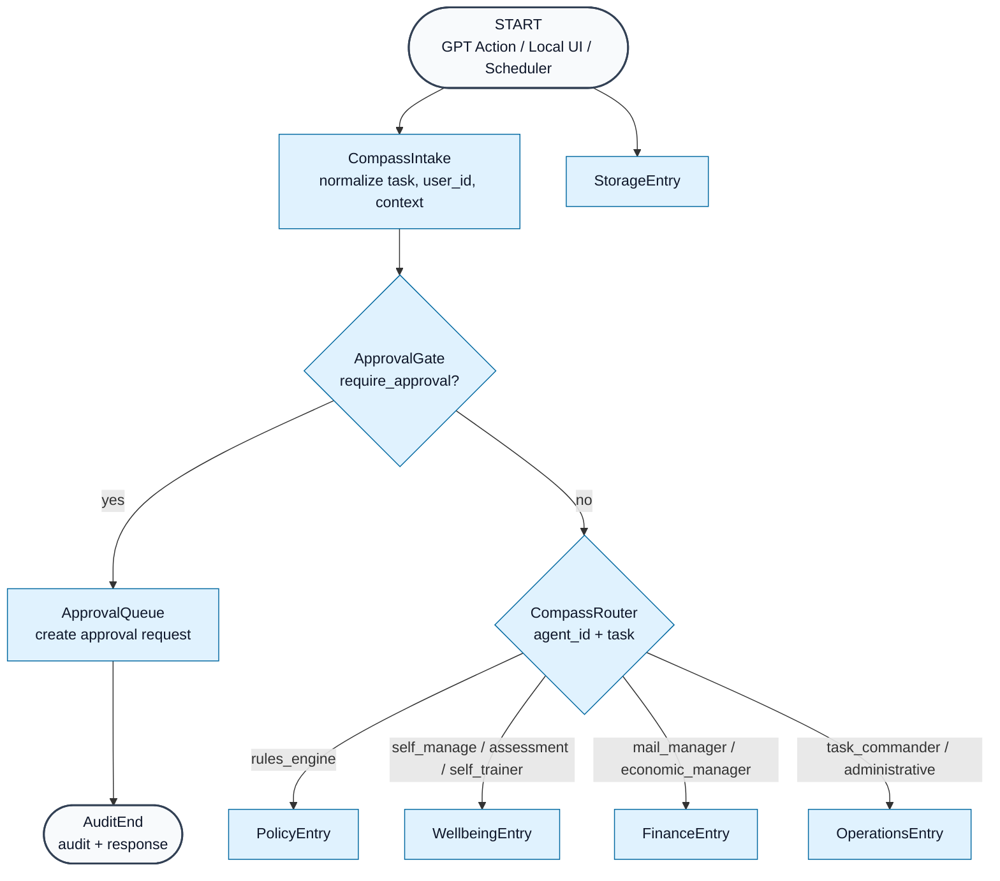
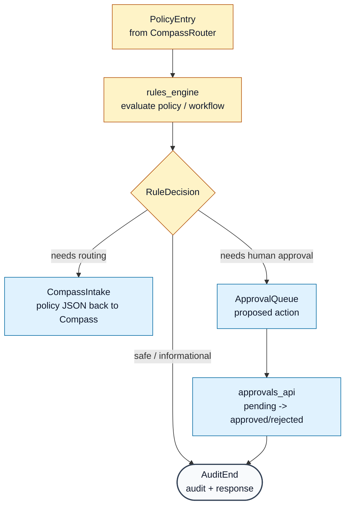
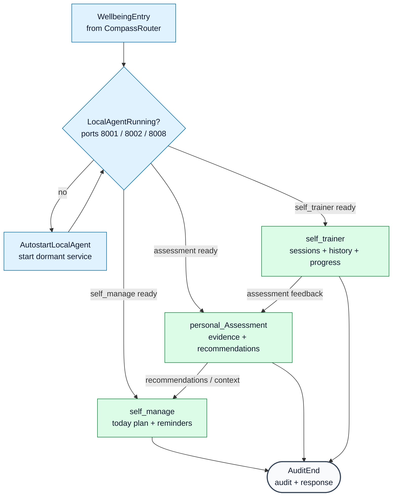
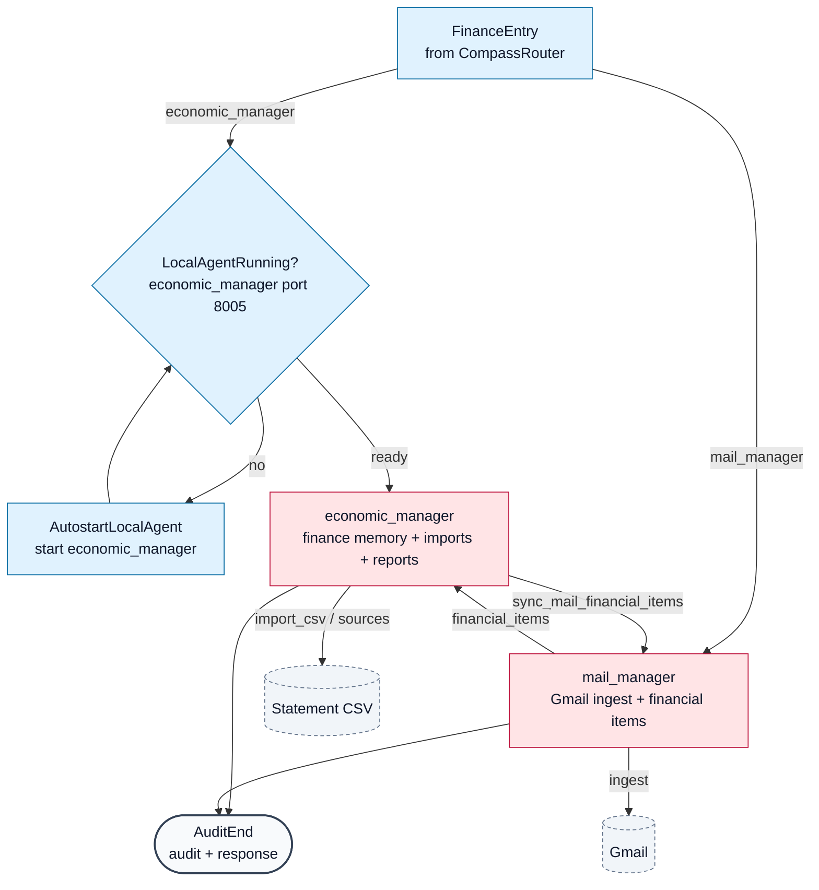
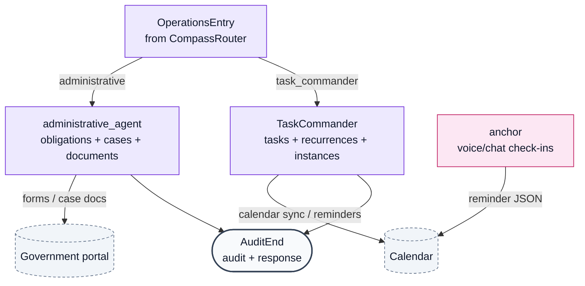
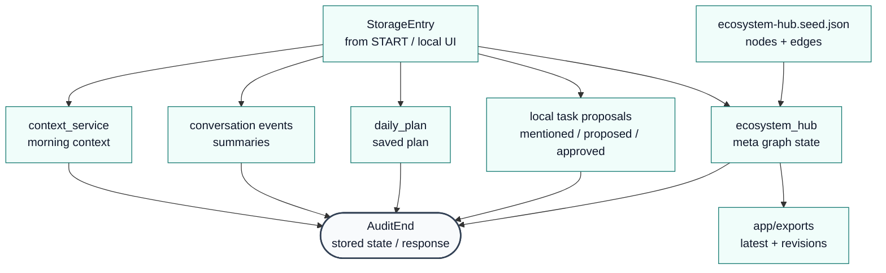

# Compass Agent LangGraph Sections

These Mermaid graphs split the Compass agent ecosystem into smaller LangGraph-style views. Shared node names, such as `CompassRouter`, `ApprovalGate`, and `AuditEnd`, indicate connection points between graphs.

## 1. Gateway And Routing

## 2. Policy And Approval Loop

## 3. Wellbeing, Assessment, Training

## 4. Finance And Mail Pipeline

## 5. Operations And Conversation

## 6. Compass Local State And Ecosystem Hub

